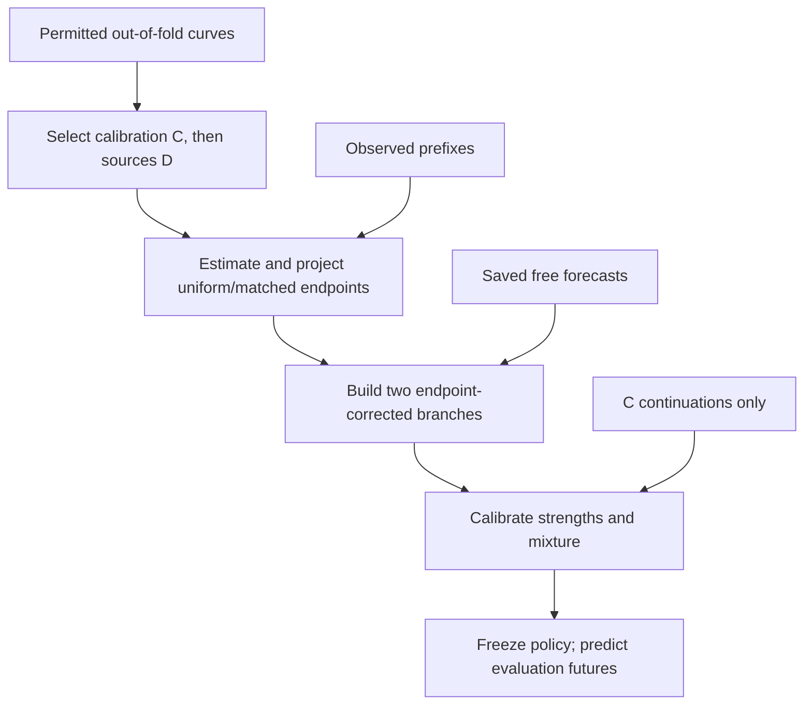

# Target-Constrained Pooling

**TCP uses completed source trajectories to improve an existing trajectory
forecast.** It combines two endpoint estimates—a uniform source average and
a change matched to the target's recent observations—and learns how strongly
to use them from a separate calibration set.

Bring your observed prefixes, completed source curves, and saved free
forecasts from any forecaster. This package provides the pooling method;
base-model training, study datasets, and paper results are not included.

## TCP workflow



Use `select_pools` to choose C and D, `estimate_endpoints` and `common_branch`
to construct the two corrections, then `calibrate` to fit a reusable `Policy`.
Apply it with `predict` to new prefixes and free forecasts. Calibration limits
mean RMSE relative to equal averaging **on C**; it is not a guarantee on new
targets.

## Quick start

Requires Python 3.10+ with NumPy, SciPy, and mpmath. From the repository root:

```sh
python -m pip install .
python examples/toy.py
python -m unittest discover -s tests -v
```

The [synthetic example](examples/toy.py) runs without external data or model
training. It prints the learned strengths, mixture weight, and predicted future
values. `predict` returns only the future tail; keep the observed prefix and
use your response coordinate's inverse transform for raw-response output.

## Using your own data

- Keep evaluation identities and continuations out of the permitted source
  and calibration pools. C and D are disjoint; identity permissions are your
  responsibility.
- Orient target and source curves consistently. For `bwd`, reverse physical
  order first. `fwd` assumes an increasing response and `bwd` a decreasing one;
  these signs are supplied assumptions, not inferred from the data.
- Keep each target's prefix, donors, saved forecast, and calibration truth in
  the same response coordinate. Preserve existing forecast maps; do not refit
  or separately normalize the originating forecaster.
- Endpoint matching needs at least five observed points and two selected
  donors. A singleton source pool is selectable but cannot support the
  leave-one-out bandwidth fit. Calibrated predictions need not be monotone.

See [method and API details](docs/method.md) for array shapes, pool selection,
coordinate conversion, numerical rules, and reproducibility limits.
